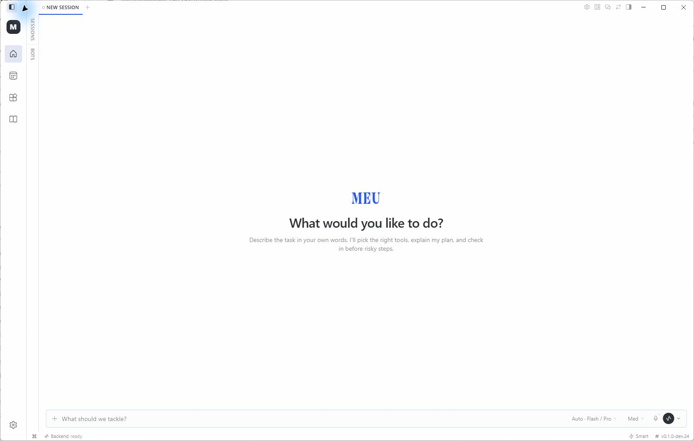
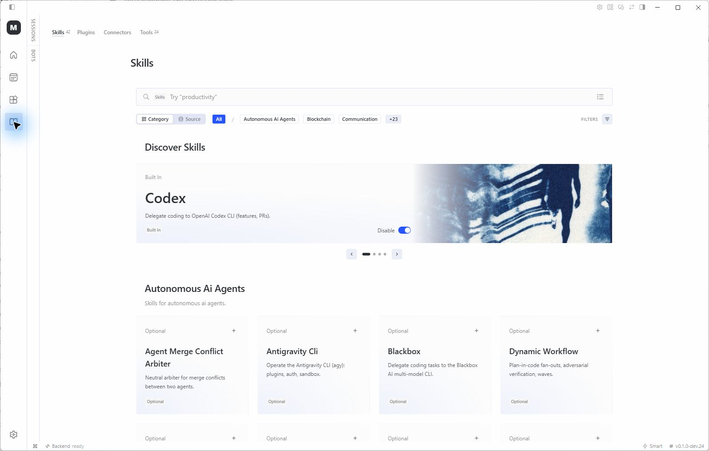
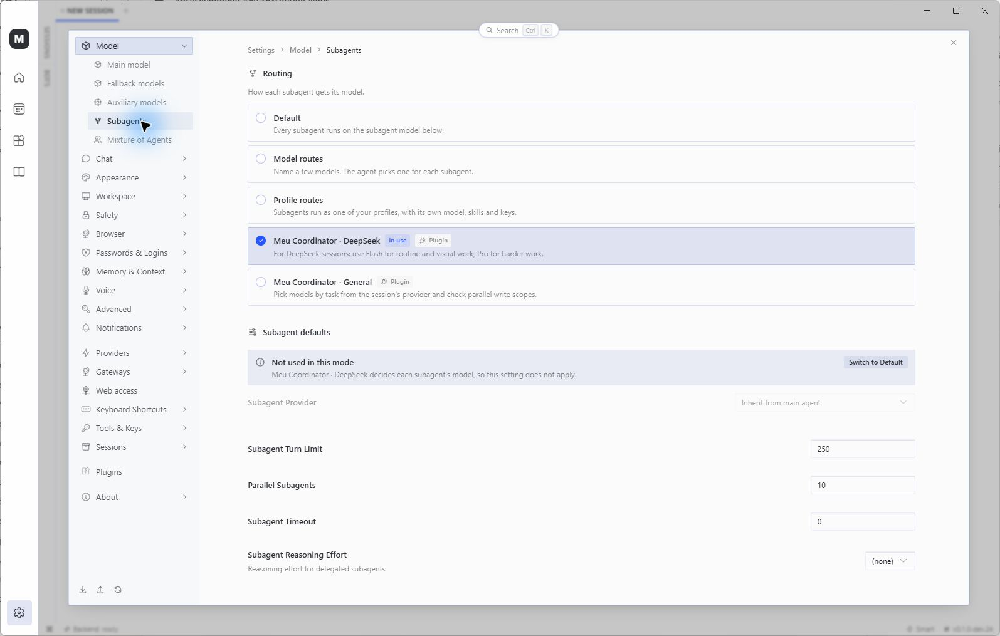

# Meu Agent

### Your AI agent. Your own workspace.

**Meu Agent** is a privacy-focused desktop AI agent and personal assistant for Windows. It works with your files and projects, recalls past conversations with persistent memory, and coordinates multiple agents on complex tasks. Use your preferred cloud LLM provider or connect a local model.

[**Visit the Meu website ↗**](https://meu-agent.witty-mite-2271.chatgpt.site/) · [**Download for Windows ↓**](https://github.com/rodos4312/Meu-Agent/releases) · [Documentation](#documentation) · [Feedback](#feedback-and-community)

*Actual Meu Windows dev.24 screenshot. Conversation history is hidden.*

## Explore Meu

[Features](#what-meu-can-do) · [Screenshots](#see-the-application) · [Quick start](#download-for-windows-x64) · [Privacy](#privacy-and-data) · [Android status](#meu-mobile) · [Documentation](#documentation)

| Capability | What it brings to your work |
| --- | --- |
| Files and projects | Read and edit files, run commands, inspect results and access project artifacts. |
| Persistent memory | Keep useful context, recall conversations and save local project decisions. |
| Meu Coordinator | Delegate scoped tasks, define acceptance criteria, save progress and review results. |
| Skills, plugins and MCP | Extend the agent with specialized workflows and optional service integrations. |
| Model choice | Connect a supported cloud provider or a compatible local model endpoint. |
| Windows updates | Check for a release and start installation from the app. |

Meu is an actively developed preview. Availability of tools and integrations depends on your configuration; some external services require a separate account or payment.

## Download for Windows x64

**[Download the latest Meu release for Windows x64](https://github.com/rodos4312/Meu-Agent/releases)** · Preview releases

Open the newest release and download its `Meu-<version>-win-x64.exe` installer.

See [Meu releases](https://github.com/rodos4312/Meu-Agent/releases) for release notes and installers.

After installation, configure your provider in **Settings → Providers** and select your model in **Settings → Model → Main model**. Check for app updates in **Settings → About → Version & updates**.

We retain the current release and up to **two previous releases**, based on version count rather than age. If your installed version is no longer available for automatic recovery, download and run the latest installer over your existing installation. Keep your Meu data folder. See the [release retention policy](docs/meu/RELEASE_RETENTION.md).

## What Meu can do

- **Choose your model provider.** Options include Anthropic, DeepSeek, Gemini, OpenAI Codex, and OpenRouter. You can also connect a local model through a compatible endpoint such as Ollama.
- **Switch between DeepSeek Flash and Pro automatically.** With DeepSeek configured, **Auto · Flash / Pro** picks a model based on the task. You can also select a model from the chat.
- **Coordinate project work.** The optional **Meu Coordinator · General** splits work into assignments, saves progress, and can delegate independent review and repair. Helpers stay on the current conversation's provider, with optional model choices for light and heavy tasks. **Meu Coordinator · DeepSeek** offers Flash and Pro routing for DeepSeek sessions. Choose a coordinator in **Settings → Model → Subagents**, then start a new chat.
- **Keep project notes locally.** Open a project in the sidebar and choose **Project notes** to view, add, edit or delete its saved decisions and preferences. Notes persist across restarts and apply to new conversations in that project. The Coordinator can pass selected notes to individual helpers; each attempt records which notes it used. See [Project memory](docs/meu/PROJECT_MEMORY.md) for scope, storage and history.

## See the application

### Skills and extensions

Browse built-in and optional skills, search by task and discover specialized workflows.

### Coordinated helpers

Choose **Meu Coordinator · General** for model selection within the conversation's provider, or **Meu Coordinator · DeepSeek** for dedicated Flash / Pro routing. Project work can carry explicit acceptance criteria, saved progress and independent review.

*Screenshots captured from the installed Windows dev.24 application. The separate workflow overview on the website is an illustration.*

## Privacy and data

**Privacy starts on your PC.** A local Meu installation stores chat history, memory and skills on your own computer. You can use Meu without a central Meu account or a Meu-hosted portal.

- A cloud model receives the input sent to it for a request. Web tools and optional integrations contact the services you choose to use.
- Compatible local models provide another option, subject to your hardware and configuration.
- Update checks contact GitHub. Diagnostic files are not automatically uploaded when you report an issue.

The application is free and MIT licensed. Model providers, eligible subscription services and optional integrations may have their own fees or usage limits.

## Meu Mobile

The Android application is being developed and tested separately, including PC connection and a local agent runtime. **The public download offered here is the Windows preview.** Follow [Discussions](https://github.com/rodos4312/Meu-Agent/discussions) for development updates; Android test builds are not presented as a finished public release.

## Documentation

| Guide | Contents |
| --- | --- |
| [Coordinator](docs/meu/COORDINATOR.md) | Delegation, model routing, verification and saved project progress. |
| [Project memory](docs/meu/PROJECT_MEMORY.md) | Scope, storage, notes and history. |
| [Distribution and updates](docs/meu/DISTRIBUTION_AND_UPDATES.md) | Windows distribution and update behavior. |
| [Development status](docs/meu/STATUS.md) | Tested changes and remaining release checks. |
| [Release retention](docs/meu/RELEASE_RETENTION.md) | Current release and up to two previous versions. |

## Feedback and community

Meu is in preview. Try it on a real task and tell us what worked and what needs improvement.

- **Bugs and installation problems:** [open an issue](https://github.com/rodos4312/Meu-Agent/issues/new/choose). Include your Meu version, the steps you took and what you expected to happen.
- **Questions, ideas and general feedback:** [start a discussion](https://github.com/rodos4312/Meu-Agent/discussions). English and Greek feedback are welcome.
- **Downloads and changes:** [browse Meu releases](https://github.com/rodos4312/Meu-Agent/releases).

Review screenshots and log excerpts before posting. Remove API keys, tokens, private conversations and personal information. Feedback is public; Meu does not upload diagnostic files automatically for an issue report.

## Development and credits

Active development takes place on [`dev/meu-foundation`](https://github.com/rodos4312/Meu-Agent/tree/dev/meu-foundation).
See [development and release status](docs/meu/STATUS.md) for tested changes and remaining release checks.

Meu is maintained as an independent repository. The previous fork is retained at [Meu-Agent-Legacy](https://github.com/rodos4312/Meu-Agent-Legacy) for historical CI runs and repository records. Current development, downloads, issues and discussions belong in this repository.

Meu is based on [Hermes Agent by Nous Research](https://github.com/NousResearch/hermes-agent). See the [MIT license](LICENSE) for license and copyright details.
